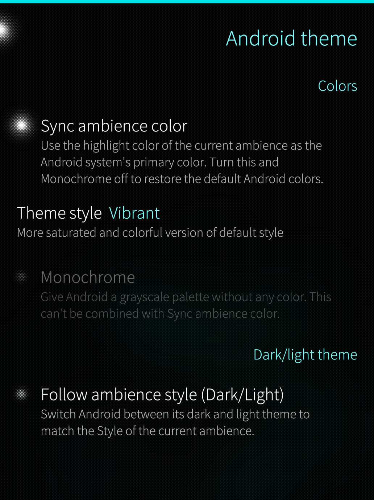
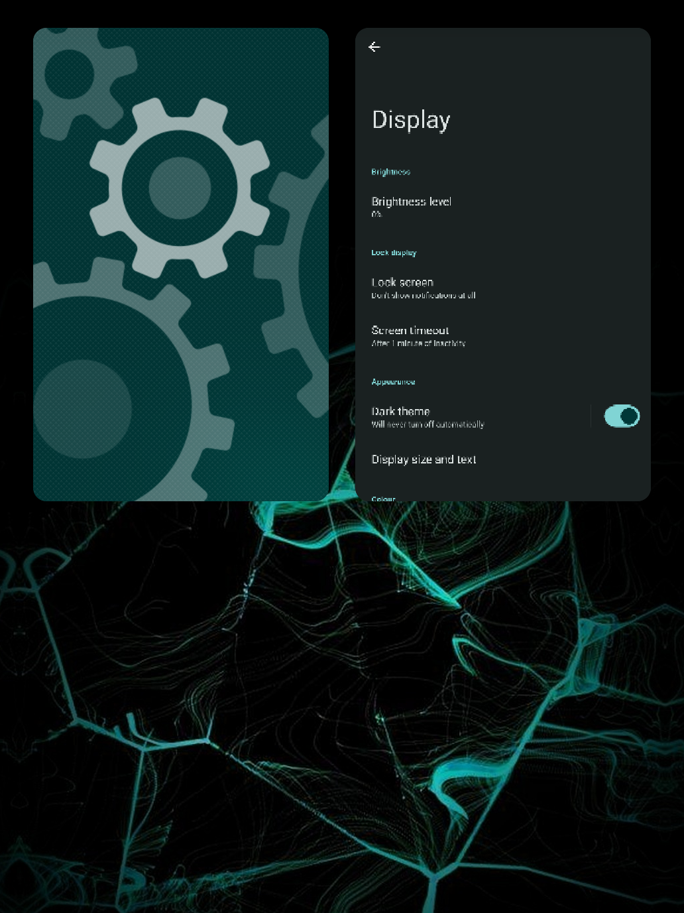
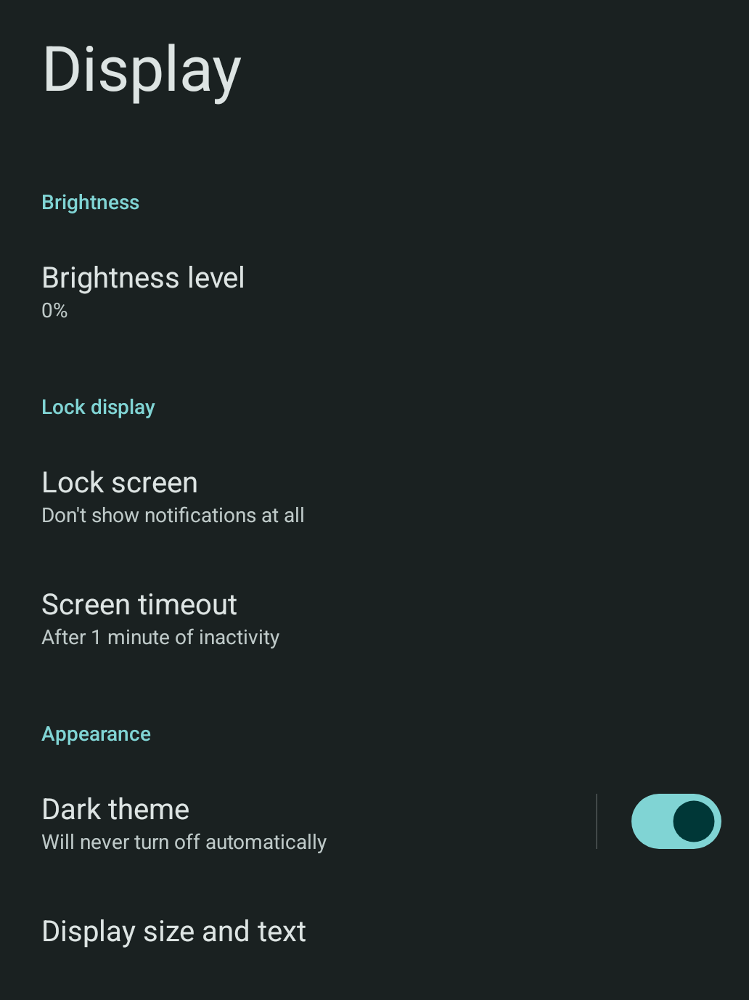
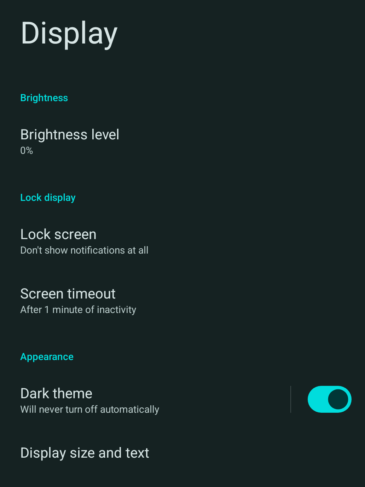

<br>
     <p align="center">
  
</p>

<h1 align="center">ambience-sync</h1>

<p align="center">
  Sync Android's primary color and dark/light mode with your Sailfish ambience.
</p>

---

**ambience-sync** adds a separate **Android theme** entry to Sailfish OS Settings (under *Look and feel*) that keeps Android apps/settings running in step with your current ambience. It matches Android's system color to the ambience's highlight color and can switch Android between its dark and light theme to match the ambience's Style.


<p align="center">
  
  
</p>
<p align="center">
  
  
</p>

## Features

- **Ambience color sync:** uses the highlight color of the current ambience as Android's system color, with a choice of color style (Tonal Spot, Vibrant or Rainbow).
- **Monochrome:** an optional grayscale Android palette.
- **Dark/light mode:** Android follows the Style (Dark or Light) of the current ambience.
- **Pure black background** (& other surfaces): option available for dark mode.
- **Match text size:** Set Android's text size to match the text size chosen in Sailfish settings (Approximate).
- **Always up to date:** changes are applied when you change the ambience or a setting, and again whenever AppSupport starts, so nothing is missed while Android was off.
- **Clean removal:** turning an option off or uninstalling restores Android's previous settings.
- **Uninstall from the settings page:** There's no launcher icon to long-press.
- **Light on resources:** nothing polls. The background service(s) sleeps until something changes.  

## Requirements

- AppSupport (the Android runtime) installed & =/> 13 (API level 33).

Some features might not work on Android < 15 (JP2), e.g. Xperia XA2.

Check [Compatibility](#compatibility) for more info.

## Installation

Note: Check files & RPMs names. Changes are not always reflected in this Readme file.

#### From the RPM

Download the latest RPM from Openrepos: https://openrepos.net/content/baboo/ambience-sync

Check files and RPMs names, as they're not always reflected in this 'readme' file.

#### From the RPM

Download the latest RPM from [Openrepos](https://openrepos.net/content/baboo/ambience-sync).

The simplest way to install it: from **Storeman**.

**OR**

From a terminal you have two options:

```sh
pkcon install-local ambience-sync-1.1.0-1.noarch.rpm   # asks you to authenticate with your device lock code
devel-su rpm -i ambience-sync-1.1.0-1.noarch.rpm       # as root, no prompt
```

#### From source, without building an RPM

Run as root from the project folder:

```sh
devel-su ./install.sh
```

### Building the RPM yourself

The spec expects a source tarball in `~/rpmbuild/SOURCES`.<br><br>From the project folder:

```sh
tar czf ~/rpmbuild/SOURCES/ambience-sync-1.1.0.tar.gz *
rpmbuild -bb ~/rpmbuild/SPECS/ambience-sync.spec
```

## Uninstalling

- Use **Uninstall** in the pull-down menu on the settings page, or
- `pkcon remove ambience-sync`, or `devel-su rpm -e ambience-sync` (RPM installs), or
- `devel-su ./install.sh --uninstall` (source installs).

For the cleanest result, uninstall while AppSupport is running, so Android's previous settings can be restored right away (see [Known limitations](#known-limitations)).

## How it works

| Part | File | What it does |
|---|---|---|
| Settings entry and page | `ambience-sync.json`, `ambience-sync.qml` | The entry in Settings and the page behind it, where you choose your options and can uninstall the app. The page only saves your choices. |
| Main service | `ambience-sync.service` | Runs as root in the background and starts the watcher script at boot. |
| Watcher script | `watch.sh` | Waits for ambience or settings changes and runs the apply script when one happens. It also carries out the uninstall from the settings page. |
| Apply script | `apply.sh` | Reads your settings and the current ambience, then sets Android's colors and dark/light mode through AppSupport. It also restores Android's previous settings when an option is turned off or the app is removed. |
| Second service | `ambience-sync-android.service` | Started by the system each time AppSupport starts. |
| Startup script | `on-appsupport-start.sh` | Run by the second service. It waits until Android is ready, then runs the apply script, so changes made while AppSupport was off aren't lost. |

```
Settings page ──writes──> dconf keys ──> watch.sh ──> apply.sh ──> Android (appsupport-attach)
Ambience change ─────────────────────────┘                ▲
AppSupport starts ──> ambience-sync-android.service ──> on-appsupport-start.sh
```

### Why root?

`appsupport-attach`, the tool that talks to the Android container, needs root. The settings page runs as a normal user and passes its choices to the root service through dconf keys. Because any user process can write those keys, the scripts treat their values as untrusted input: colors must match a fixed format, styles come from a fixed list, and the uninstall request can only remove this package. Nothing from dconf is ever executed.


## Known limitations

- Dark/light: the script saves Android's current night mode (`auto`, `yes` or `no`) in `/var/lib/ambience-sync/` and puts it back when the option is turned off or the app is removed. Android's mode is changed with `cmd uimode night`, because simply changing the `ui_night_mode` setting isn't picked up by Android/AppSupport.
- If you uninstall while AppSupport is off, Android can't be reached to restore its previous settings, so uninstall with Android running.
- While *Follow ambience style* is on, a dark/light mode you set by hand in Android is overridden at the next ambience change. Turning the option off restores the mode Android had before you first switched it on.
- The app hardcodes the user `defaultuser` and the `appsupport@defaultuser` service, as on standard Sailfish OS devices.

## Compatibility

**Colors may not work on some Android versions.** Sync ambience color, Monochrome and Pure black rely on Android's system color overlays. On the AppSupport 13 of the **Sony Xperia XA2**, Android does not create these overlays: its overlay list is empty and applying a color fails inside Android itself ("commit failed" in the Android log). Nothing the app writes can fix that.

On devices where this happens, the script(s) detects it (Android's overlay list is empty) and greys out the color options on the settings page, with a note saying so. Follow ambience style (dark/light) and Match text size do not depend on overlays so they work on both devices.

Only these two devices have been tested. Other Android 13 builds may work, so reports are welcome.

## Notes
- Built & tested on JP2 *v5.2.0.18/20/22*.
- Also tested on XA2 **v5.1.0.11*, v5.2.0.22*. 
